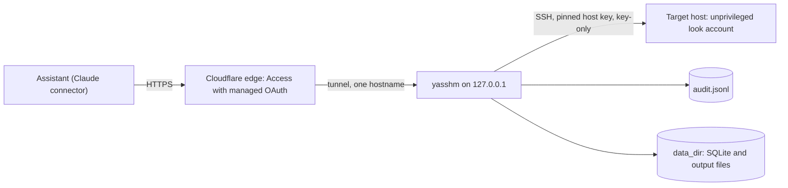

# yasshm operator guide

This guide is for the person who runs a yasshm gateway: installs it, points it at SSH hosts, connects an AI assistant to it and reads its audit log. It describes version 0.1 as built. Where it states a number, a key, a code or a log line, a test in this repository checks it against the code, so it cannot drift; where it states something about an outside service, it says whether it was read in the vendor's documentation (CONFIRMED, with the date) or is INFERRED.

Other documents: [deploy/README.md](../deploy/README.md) has the install steps, [SECURITY.md](../SECURITY.md) the threat model and how to report a vulnerability, [TESTING.md](../TESTING.md) how the project is tested and the operator's manual tests, and [the design spec](superpowers/specs/2026-11-18-yasshm-design.md) the reasons behind every decision.

## What yasshm is

yasshm ("Yet Another SSH MCP") is one static Go binary that you run as a systemd service on a Linux host you control. It serves eight MCP tools over Streamable HTTP, so an AI assistant (a Claude custom connector, for example) can run commands, read their output and fetch files on SSH hosts that you have listed in its config file. It adds what a bare SSH key cannot: every request is authenticated, checked against policy and written to an audit log before anything runs; commands that outlive one tool call become jobs the assistant can poll, page and kill.



- **The edge** (Cloudflare Tunnel plus Access) does the sign-in. yasshm ships no OAuth server and opens no inbound port: it listens on loopback and the tunnel connector on the same host forwards one public hostname to it.
- **The origin check.** yasshm verifies the Access token on every request (signature, issuer, audience, expiry) and maps the caller to a tenant through the `principals` list in its config. There is no unauthenticated mode, so a request that goes around the edge gets 401.
- **The target.** Commands run as an unprivileged account on the target, over SSH with a key that the gateway holds and a host key that you pinned. The assistant never sees the host name, the login name, the key or any config value: the tools expose a server's id, description, tags and access level only.
- **State.** Command records live in SQLite and captured output in files, both under `data_dir`. The audit log is one append-only JSONL file.

## What yasshm is not

Read this before pointing it at a machine you care about. These are the spec's own words (section 6), and each is checked against `README.md` and the code by a test.

- **The `look` level is an unprivileged account, not a sandbox.** A command at `look` runs as the account you made on the target. What a command can change is decided by that account and the target's operating system, not by yasshm. Make the account unprivileged, outside every privileged group, with no `sudo` rights.
- **The denylist is a guard rail, not a boundary.** The command and path denylists catch the obvious (privilege escalation, power control, raw device writes, recursive deletes of `/`, pipe-to-shell downloads, a fork bomb, shadow files, private keys, common secret file names), and you can add your own. They are regular expressions and globs, not a shell parser, and they can be bypassed: the package documentation and spec section 5.3 list the known ways (a command word built at run time, an option that takes a value before the command, a wrapper the list does not know, a download saved and run later, a symbolic link on the target, and more). Do not rely on them to keep a command harmless.
- **Output from a target is untrusted text.** A compromised or hostile target can put instructions in its output, and the assistant reads that output. The tool descriptions label output as untrusted and the gateway keeps its own text in a separate block, but whether a model acts on text it reads is not something yasshm can guarantee.
- **Output is not free of secrets.** Captured output is stored under the data directory and returned to the assistant as it is: whatever a command prints from the target, a secret included, goes to both places. The audit log holds command text (so a secret typed into a command is in it) but never output.
- **No availability guarantee under a flood** from a host that can reach the loopback listener. Rejected requests are answered and their audit lines are bounded, but nothing limits the request rate itself; the edge is what stops a flood from the internet.
- **No protection from another local user.** If a local user binds the loopback port while the gateway is down (a restart, an upgrade, a crash loop), that user receives what the edge forwards, tokens and command text included. Run the gateway on a host with no untrusted local users.
- **Out of scope:** attacks that need root on the gateway host, and the edge's own configuration.

## Before you start

- A Linux host for the gateway that can reach your SSH targets and the edge's key-set host, with systemd and no untrusted local users.
- A Cloudflare account with a domain, Tunnel and Access (Zero Trust). The steps for the edge are the vendor's; see [Connecting a Claude custom connector](#connecting-a-claude-custom-connector).
- On each target, an unprivileged account and the ability to add one `authorized_keys` line to it.
- A way to verify a host key out of band. There is no trust on first use.

[deploy/README.md](../deploy/README.md) walks through the install in order. The rest of this guide is reference.

## The config file

The config is one YAML file, `/etc/yasshm/config.yaml` in the install steps, read once at start. Change it and restart the service; there is no reload. It is decoded strictly: an unknown key, a duplicate key, a wrong type, a missing required key, a YAML anchor or an alias is an error, and every problem is reported at once as `path.to.key: message (line N)`. Problem paths name list items by index and id, for example `tenants[0](default).servers[0](lab-1).host_key`. `yasshm config check --config <file>` validates the file and the files it names (private keys, `known_hosts` files) without connecting anywhere, and prints `config ok: 1 tenant, 1 server` on success. [deploy/config.example.yaml](../deploy/config.example.yaml) is a complete example with a comment on every key, and a test loads it through the real loader.

File rules: at most 1 MiB, one YAML document, not writable by group or other (the gateway refuses it, because whoever can write it decides what the gateway trusts). Ids (tenant, identity, server, tag) match `^[a-z0-9][a-z0-9-]{0,62}$`. Exactly one tenant is accepted in this version. Four cross-field rules hold for the limits: `default_wait_seconds` is at most `max_wait_seconds`, `default_timeout_seconds` at most `max_timeout_seconds`, `max_concurrent_per_server` at most `max_concurrent_commands`, and `max_output_bytes` at most `max_data_bytes`; and `max_wait_seconds` plus twice `connect_timeout_seconds` must not exceed 120.

The table lists every key the loader accepts. Paths are written from the top of the file; `[]` marks a list item and `NAME` the id that keys a mapping. A test checks that the table holds exactly the keys the decoder accepts and that every limit's default and range equal the limits table in the code.

<!-- config-reference:begin -->
| Key | Required | Default | Range or form | Meaning |
|---|---|---|---|---|
| `version` | yes | none | 1 | The config format version. |
| `server.listen` | yes | none | loopback IP and port | Where the gateway binds, for example `127.0.0.1:8822`. A host name is refused, and so is a non-loopback address unless `allow_non_loopback` is true. Port 0 asks the kernel for a free port (tests). |
| `server.allow_non_loopback` | no | false | true or false | Lets `listen` be any address. Leave it off: it exposes the gateway without the edge in front of it. |
| `server.data_dir` | yes | none | absolute clean path | The directory for the job database and captured output. Must exist, be owned by the service user and have mode 0700. |
| `server.audit_log` | yes | none | absolute clean path | The append-only JSONL audit log. Created with mode 0600; its directory must not be writable by group or other. |
| `auth.provider` | yes | none | `cloudflare-access` | The origin authentication. The only provider. |
| `auth.cloudflare_access.team_domain` | yes | none | DNS host name | The Access team domain. The token's issuer must be `https://` plus this, and the signing keys come from `https://<team domain>/cdn-cgi/access/certs`. |
| `auth.cloudflare_access.audience` | yes | none | 1 to 512 characters, no spaces | The AUD tag of the Access application. Every token must carry it in `aud`. |
| `auth.cloudflare_access.certs_url` | no | the team domain's URL | https URL (http for a loopback IP) | Replaces the key-set URL. For tests: the gateway logs a warning when it is set. |
| `tenants[].id` | yes | none | id pattern | The tenant's id. |
| `tenants[].principals[].email` | one of two | none | ASCII email address | An Access user, compared ignoring ASCII case. |
| `tenants[].principals[].common_name` | one of two | none | 1 to 256 characters, no spaces | An Access service token's client id. |
| `tenants[].identities.NAME.user` | yes | none | login name, at most 32 characters | The account on the target. |
| `tenants[].identities.NAME.private_key_file` | yes | none | absolute clean path | The gateway's private key for that account: no passphrase, a regular file owned by the service user with mode 0600, at most 64 KiB. |
| `tenants[].servers[].id` | yes | none | id pattern | The id the assistant uses. Unique in the tenant. |
| `tenants[].servers[].description` | no | empty | at most 256 bytes, no control characters | Shown to the assistant. |
| `tenants[].servers[].host` | yes | none | DNS host name or IP address | The target. |
| `tenants[].servers[].port` | no | 22 | 1 to 65535 | The target's SSH port. |
| `tenants[].servers[].identity` | yes | none | an identity id | Which identity to log in with. |
| `tenants[].servers[].host_key` | one of two | none | one `authorized_keys` line, no options | The pinned host key. |
| `tenants[].servers[].known_hosts_file` | one of two | none | absolute clean path, at most 1 MiB | A `known_hosts` file that lists the server's host and port; not writable by group or other; no `@cert-authority` line. |
| `tenants[].servers[].access` | yes | none | `look` | The level the server grants. `full` is refused in this version. |
| `tenants[].servers[].tags` | no | none | at most 16 id patterns | Shown to the assistant. |
| `tenants[].policy.deny_commands` | no | none | at most 256 RE2 expressions of at most 1024 bytes | Your additions to the command denylist, matched unanchored against the whole command. An expression that matches the empty string is refused. |
| `tenants[].policy.deny_paths` | no | none | at most 256 globs of at most 1024 bytes | Your additions to the path denylist for file transfer. A glob without a slash matches the base name; one with a slash starts with `/` or `**/`. |
| `tenants[].limits.default_wait_seconds` | no | 30 | 0 to 110 | How long `run_command` and `read_output` wait when the caller names no wait. 0 answers at once. |
| `tenants[].limits.max_wait_seconds` | no | 60 | 1 to 110 | The longest wait a caller may ask for. |
| `tenants[].limits.default_timeout_seconds` | no | 600 | 1 to 86400 | How long a command may run when the caller names no timeout. |
| `tenants[].limits.max_timeout_seconds` | no | 3600 | 1 to 86400 | The longest timeout a caller may ask for. |
| `tenants[].limits.max_concurrent_commands` | no | 4 | 1 to 64 | Commands running at once; over it a call is refused with `busy`. |
| `tenants[].limits.max_concurrent_per_server` | no | 2 | 1 to 64 | Commands, probes and transfers running at once on one server. |
| `tenants[].limits.max_command_bytes` | no | 8192 | 1 to 65536 | The longest command text accepted. |
| `tenants[].limits.max_output_bytes` | no | 16777216 | 1024 to 1073741824 | The most output stored per command; the rest is dropped and the command is marked truncated. |
| `tenants[].limits.max_result_bytes` | no | 100000 | 4096 to 140000 | The most bytes in one tool result. |
| `tenants[].limits.retention_days` | no | 7 | 1 to 3650 | How long a finished command and its output are kept. |
| `tenants[].limits.max_data_bytes` | no | 1073741824 | 1048576 to 1099511627776 | The most the tenant's records and stored output may hold. |
| `tenants[].limits.max_upload_bytes` | no | 1048576 | 1 to 1048576 | The most `upload_file` may send. Uploads are refused in this version. |
| `tenants[].limits.kill_grace_seconds` | no | 5 | 1 to 60 | Between TERM and KILL when the gateway ends a command. |
| `tenants[].limits.connect_timeout_seconds` | no | 10 | 1 to 59 | How long the gateway waits to connect and to start a command on a target. |
| `tenants[].limits.shutdown_grace_seconds` | no | 20 | 1 to 300 | How long a graceful stop waits for running commands to end. |
<!-- config-reference:end -->

The built-in denylist entries have stable rule names, which appear as `rule` in a `policy_denied` answer and in the audit log. Commands: `sudo`, `su`, `doas`, `pkexec`, `run0`, `power-control`, `init-runlevel`, `systemctl-power`, `fs-create`, `dd-to-device`, `write-to-device`, `rm-root`, `rm-no-preserve-root`, `pipe-to-shell`, `download-substitution`, `fork-bomb`. Paths: `shadow`, `sudoers`, `ssh-host-key`, `ssh-private-key`, `key-file`, `env-file`, `credential-file`, `cloud-credentials`, `proc-secrets`, `proc-links`. Your own entries are named `config:deny_commands[n]` and `config:deny_paths[n]` by position. The other checks are `server-not-found`, `access-level`, `command-empty`, `command-nul`, `command-invalid-utf8`, `command-too-long`, `path-empty`, `path-nul`, `path-invalid-utf8`, `path-not-absolute` and `path-too-long`.

## Adding a server and pinning its host key

A server entry needs three things on the target and three in the config.

1. On the target, an unprivileged account (the `look` account) whose `authorized_keys` line for the gateway's public key starts with `restrict` and has no forced command. `restrict` turns off forwarding, a terminal and the rest; a forced command would stop the gateway from signalling a command (an SSH `signal` request is not delivered under a forced command), and then `kill_command` could not work. [deploy/README.md](../deploy/README.md) has the exact line.
2. The target's host key, as one line. Get it from the target itself (the `.pub` file of the host key it serves, read over a channel you trust) or from `ssh-keyscan` and compare its fingerprint with the one the target reports. Never accept what a first connection shows: a gateway that pins an unknown key can be pointed at an impostor.
3. The gateway's private key for that account, generated on the gateway host.

In the config: an `identities` entry (the account name and the key file), a `servers` entry that names that identity and carries `host_key` (or a `known_hosts_file`), and `access: look`. Run `yasshm config check`, restart the service, and ask the assistant to call `get_server_info` for the new server: `reachable`, `host_key_ok` and a few facts (kernel, architecture, OS, uptime) come back. A target whose host key is not the pinned one is never spoken to past the handshake: the call fails with `host_key_mismatch` and the mismatch is in the audit log. After a legitimate host key change (a reinstall), replace `host_key` with the new line after checking it, and restart.

## Connecting a Claude custom connector

yasshm is reached by a Claude custom connector through your own edge. The facts below were read in the vendor's pages on 2026-11-20 unless marked INFERRED; the pages change, so follow them for the clicks.

**What Claude needs.** Streamable HTTP is the transport for a remote server; the older SSE transport is being deprecated (CONFIRMED, [Build an MCP server for Claude](https://claude.com/docs/connectors/building)). Sign-in is OAuth, with the callback `https://claude.ai/api/mcp/auth_callback` for the hosted apps and a loopback redirect for Claude Code (CONFIRMED, same page; F2 in the spec). Claude connects from Anthropic's infrastructure, so the server needs a public URL. A tool call times out after 240 seconds and a result is capped at about 150,000 characters in claude.ai and the desktop app (CONFIRMED, same page). You add the connector by its URL under Customize, Connectors (CONFIRMED, [Test your connector](https://claude.com/docs/connectors/building/testing)); on a Team or Enterprise plan an Owner adds it. The connector's URL is your public hostname with the path `/mcp`.

**The tunnel.** Run the Cloudflare Tunnel connector (`cloudflared`) on the gateway host and route one public hostname to `http://127.0.0.1:8822` (the port in `server.listen`). The connector makes outbound connections only, so the host needs no inbound port (CONFIRMED, [Cloudflare Tunnel](https://developers.cloudflare.com/cloudflare-one/connections/connect-networks/), which links the steps to create a tunnel). A tunnel buffers a response unless it is an event stream, and the edge closes a request whose origin sends nothing for 125 seconds (CONFIRMED in the vendor's error 524 page, 2026-11-19; not observed by us until MT-003). That is why yasshm answers a tool call with plain JSON only when it is done and why `max_wait_seconds` has the ceiling it has (see [Limits and tuning](#limits-and-tuning)).

**The Access application.** Put a self-hosted Access application in front of that hostname, with a policy that admits you (and nobody else), and turn on Managed OAuth for it. Managed OAuth makes Access act as the OAuth authorization server for non-browser clients; Claude then signs in through Access and yasshm needs no OAuth code of its own (CONFIRMED in [Managed OAuth](https://developers.cloudflare.com/cloudflare-one/access-controls/applications/http-apps/managed-oauth/): "Zero Trust > Access controls > Applications > Edit > Advanced settings > Managed OAuth"; the OAuth client must support RFC 8707; a client's redirect URIs are limited by the application's allowed-redirect-URI setting). Two things follow that the page does not state, so they are INFERRED: that the connector's callback URL above must be among the allowed redirect URIs, and that the whole flow works with a Claude connector (F9; it is exercised by the manual test MT-001, never by the build). Do not enable Managed OAuth if you run your own OAuth server behind Access (vendor's warning).

**What goes into the config.** Two values, both from the Access side: the team domain (`auth.cloudflare_access.team_domain`, for example `example-team.cloudflareaccess.com`) and the application's AUD tag (`auth.cloudflare_access.audience`). The vendor's page on validating the Access token ([Validate JWTs](https://developers.cloudflare.com/cloudflare-one/access-controls/applications/http-apps/authorization-cookie/validating-json/)) describes the token and where the AUD tag is shown. The origin receives the token in the `Cf-Access-Jwt-Assertion` header (CONFIRMED, vendor, 2026-11-19) and verifies it on every request. Then map yourself: your Access login email goes into `principals` as `email`. Map a `common_name` (a service token's client id) only for a service token you created: yasshm treats any token that carries a `common_name` as a service token and admits it if that name is listed.

**Check it.** From the gateway host, `/healthz` answers `ok` once the key set is loaded. Add the connector, sign in, and ask for `list_servers`; the audit log shows `auth.accepted` and `tool.called`. A request that reaches the loopback port directly, without the edge, gets 401: try it from the gateway host before you rely on it (MT-005 does the public half).

## The tools

Eight tools, no others. Every call is checked in the same order: the caller's tenant owns the server; the server grants the level the tool needs; the arguments pass the guard rails. `upload_file` needs `full`, which no server can grant in this version, so every call is refused with `access_denied`.

<!-- tools:begin -->
| Tool | Needs | What it does |
|---|---|---|
| `list_servers` | a signed-in caller | Lists your tenant's servers: id, description, tags, access level. |
| `get_server_info` | `look` | Shows a server's description, tags and level, and runs a fixed read-only probe: reachable, round trip, host key check, kernel, architecture, OS and uptime. An unreachable server is a normal answer. |
| `run_command` | `look` | Runs a shell command as the server's account, waits up to `wait_seconds`, and returns its status and the first page of output. A command still running keeps running. |
| `read_output` | `look` | Reads a page of a command's output from an offset (negative counts from the end), optionally waiting for new output. |
| `list_commands` | `look` when a server is named | Lists the tenant's commands, newest first. |
| `kill_command` | `look` | Sends TERM (default), INT or KILL to a running command's process group. Idempotent on a finished command. |
| `download_file` | `look` | Reads up to `max_bytes` of a regular file over SFTP, behind the path denylist. |
| `upload_file` | `full` | Refused with `access_denied` in this version. |
<!-- tools:end -->

A command record has one of seven statuses. `running` is the only one a record leaves, once.

<!-- statuses:begin -->
| Status | Meaning |
|---|---|
| `running` | The command was accepted and has not finished. |
| `succeeded` | It exited 0. |
| `failed` | It exited non-zero, or a signal nobody here sent ended it. |
| `killed` | It ended after a kill request, or the gateway shut down. |
| `timed_out` | It passed its timeout and was stopped. |
| `lost` | The gateway died while it ran. The output captured so far stays readable. |
| `error` | The gateway could not run it (the record carries an `error_code`). |
<!-- statuses:end -->

## Running, upgrading and rolling back

**Start and stop.** `systemctl start yasshm` runs `yasshm config check` first and starts the gateway only if it passes; a config problem shows in `journalctl -u yasshm` as one `config problem` line per problem. A stop is graceful: on `SIGTERM` the gateway stops accepting, ends the running commands (they are marked `killed`) within `shutdown_grace_seconds`, writes `gateway.stopped` and exits 0. A second signal exits at once. The unit's `TimeoutStopSec` is longer than the largest allowed grace.

**A restart ends running commands.** A command is a child of the gateway's SSH connection. After a stop they are `killed`; if the gateway dies instead (a crash, a power cut), the next start marks every `running` record `lost`, and a lost record says the remote process may still be running, because nobody stopped it. See [what "may still be running" means](#may-still-be-running).

**Upgrade.**

1. Download the new release files and `SHA256SUMS`, and verify them (`sha256sum --check --ignore-missing SHA256SUMS`).
2. Read the changelog. Back up the data directory if you want the old command records back after a rollback (`systemctl stop yasshm`, copy `/var/lib/yasshm`, keep its modes).
3. Install the new binary over `/usr/local/bin/yasshm` and run `yasshm config check --config /etc/yasshm/config.yaml` with the new binary.
4. `systemctl restart yasshm`. Check `journalctl -u yasshm` for `listening` and `readiness`, `/healthz`, and the `gateway.started` event with the new `version`.

The gateway is down from the stop to the start, and while it is down the loopback port is free for any local user (see [Operational notes](#operational-notes)).

**Roll back.** Reinstall the previous binary and restart. The database schema moves forward only: a binary that finds a database newer than it understands refuses to start with `the database was written by a newer yasshm`. Then restore the data directory from the backup you took before the upgrade (you lose the command records written since), or keep the new binary.

**Uninstall.** Stop and disable the unit, remove the unit file, the binary and `/etc/yasshm`, and decide what to do with `/var/lib/yasshm` (command output, possibly with secrets from targets) and `/var/log/yasshm` (the audit log). Remove the gateway's public key from every target's `authorized_keys`, delete the target accounts if you made them for this, and remove the tunnel route and the Access application.

## The data directory and retention

`data_dir` (mode 0700, owned by the service user) holds `yasshm.db` (SQLite in WAL mode, with `-wal` and `-shm` files beside it while the gateway runs), `yasshm.lock` (one gateway per data directory: a second gateway on the same directory refuses to start with `the data directory is in use by another gateway`) and `tenants/<tenant>/commands/<command id>/stdout` and `stderr` (output, directories 0700 and files 0600). With `merge_stderr` true, the default, both streams go to `stdout` in arrival order.

Output can contain secrets from a target. Treat the data directory as sensitive: it is private to the service user, and it should not be backed up to a place that is not.

**Retention.** A janitor runs at start and every hour. It deletes finished commands (record first, then the output directory) older than `retention_days`, and then, while the tenant's stored bytes exceed `max_data_bytes`, the oldest finished ones. A running command is never deleted. While usage is at or above `max_data_bytes` a new command is refused with `busy` naming `max_data_bytes`. A command whose output passes `max_output_bytes` keeps what was stored up to the limit and is marked `truncated`; the gateway keeps draining the remote output so the command does not block.

## The audit log

`audit_log` is a JSONL file: one JSON object per line, appended with `O_APPEND`, mode 0600, synced after every event. It holds command text, paths and who did what, never tokens, key material, file content or command output. It is the record of what the gateway did on your behalf, so keep it.

**Audit before act.** Before a command starts, a signal is sent or a file moves, the gateway writes the event that announces it (`tool.called`, `command.requested`, `command.kill_requested`, the `requested` form of a file event). If that write or its sync fails, the action does not happen and the call answers `internal` ("the audit log could not be written, so nothing was done"). After any failed write the gateway refuses every later write until it is restarted, because a failed write can leave a partial line; every request then gets 503 (see [HTTP statuses](#http-statuses)). Free the disk or fix the permission, then restart.

**The fields.** Every event has `ts` (RFC 3339 with fractional seconds, UTC) and `event`. Most carry `request_id` (the 32 hex digits that tie together the events of one HTTP request), `tenant` and `principal` (`user:<email>` or `service:<client id>`). Then, where they apply: `tool`, `server`, `command_id`, `decision` (`allow` or `deny`), `code` (a tool error code), `rule` (the policy rule that matched), and the event-specific fields `reason`, `args` (the call's arguments: ids and enums only if they match their pattern, otherwise `(invalid)`; `command` cut at `max_command_bytes` and `path` at 4096 bytes with the marker ` [cut for the audit log]`; upload content never, only `content_bytes`), `command`, `timeout_seconds`, `status`, `exit_code`, `signal`, `error_code`, `stdout_bytes`, `stderr_bytes`, `truncated`, `duration_ms`, `stage`, `path`, `offset`, `bytes`, `mode`, `overwrite`, `version`, `listen` and `count`. A field with no value is left out.

**The events.** `gateway.started` and `gateway.stopped` bracket a run. `auth.accepted` and `auth.rejected` record each request at the guard. `tool.called` records every tool call (arguments included). A call refused by the guard rails writes `policy.denied`; any other error answer writes `tool.failed` with the code and no message. A command writes `command.requested` (full command text, written before the SSH session starts), `command.started` and `command.finished` (status, exit code or signal, byte counts, duration; never output); a kill writes `command.kill_requested` before the signal is sent. File transfers write `file.downloaded` and `file.uploaded` twice: once with `stage` `requested` before the transfer and once with `done` after. In this version `upload_file` is always refused, so `file.uploaded` is never written; it is shown here so you know the shape. A caller that went away before the answer shows up as `tool.failed` with code `client_closed`, which is not one of the ten tool codes and was never sent to anyone.

These are real lines, written by the audit package with a fixed clock. A test writes the same events and compares them with this block, so the shapes are exact. Identifiers are synthetic.

<!-- audit-samples:begin -->
```text
{"ts":"2026-11-20T12:00:01.123Z","event":"gateway.started","version":"0.1.0","listen":"127.0.0.1:8822"}
{"ts":"2026-11-20T12:00:02.123Z","event":"auth.accepted","request_id":"9f2c4e1ab07d4c35a1e86b3d5f70c2e4","tenant":"default","principal":"user:operator@example.net","decision":"allow"}
{"ts":"2026-11-20T12:00:03.123Z","event":"auth.rejected","request_id":"1b7e0d52c9a34f6e8d21a0f4b6c83e97","decision":"deny","reason":"missing_token"}
{"ts":"2026-11-20T12:00:04.123Z","event":"auth.rejected","request_id":"5d0a93c7e1b24a68b3f9c2e07d14a856","principal":"user:stranger@example.net","decision":"deny","reason":"unmapped_principal"}
{"ts":"2026-11-20T12:00:05.123Z","event":"auth.rejected","decision":"deny","reason":"suppressed","stage":"unverified","count":412}
{"ts":"2026-11-20T12:00:06.123Z","event":"tool.called","request_id":"9f2c4e1ab07d4c35a1e86b3d5f70c2e4","tenant":"default","principal":"user:operator@example.net","tool":"run_command","server":"lab-1","args":{"command":"uptime","wait_seconds":30,"merge_stderr":true}}
{"ts":"2026-11-20T12:00:07.123Z","event":"policy.denied","request_id":"9f2c4e1ab07d4c35a1e86b3d5f70c2e4","tenant":"default","principal":"user:operator@example.net","tool":"run_command","server":"lab-1","decision":"deny","code":"policy_denied","rule":"sudo"}
{"ts":"2026-11-20T12:00:08.123Z","event":"tool.failed","request_id":"9f2c4e1ab07d4c35a1e86b3d5f70c2e4","tenant":"default","principal":"user:operator@example.net","tool":"run_command","server":"lab-1","code":"ssh_unreachable"}
{"ts":"2026-11-20T12:00:09.123Z","event":"command.requested","request_id":"9f2c4e1ab07d4c35a1e86b3d5f70c2e4","tenant":"default","principal":"user:operator@example.net","tool":"run_command","server":"lab-1","command_id":"3a9f0c71d2e84b5690a1c7e8f4d25b36","command":"uptime","timeout_seconds":600}
{"ts":"2026-11-20T12:00:10.123Z","event":"command.started","request_id":"9f2c4e1ab07d4c35a1e86b3d5f70c2e4","tenant":"default","principal":"user:operator@example.net","server":"lab-1","command_id":"3a9f0c71d2e84b5690a1c7e8f4d25b36"}
{"ts":"2026-11-20T12:00:11.123Z","event":"command.finished","request_id":"9f2c4e1ab07d4c35a1e86b3d5f70c2e4","tenant":"default","principal":"user:operator@example.net","server":"lab-1","command_id":"3a9f0c71d2e84b5690a1c7e8f4d25b36","status":"succeeded","exit_code":0,"stdout_bytes":62,"stderr_bytes":0,"truncated":false,"duration_ms":840}
{"ts":"2026-11-20T12:00:12.123Z","event":"command.finished","request_id":"9f2c4e1ab07d4c35a1e86b3d5f70c2e4","tenant":"default","principal":"user:operator@example.net","server":"lab-1","command_id":"c41e7b09a2d3458f9e60b1d7a38c5f24","status":"timed_out","signal":"TERM","stdout_bytes":1048576,"stderr_bytes":0,"truncated":true,"duration_ms":600000}
{"ts":"2026-11-20T12:00:13.123Z","event":"command.kill_requested","request_id":"9f2c4e1ab07d4c35a1e86b3d5f70c2e4","tenant":"default","principal":"user:operator@example.net","tool":"kill_command","command_id":"c41e7b09a2d3458f9e60b1d7a38c5f24","signal":"TERM"}
{"ts":"2026-11-20T12:00:14.123Z","event":"file.downloaded","request_id":"9f2c4e1ab07d4c35a1e86b3d5f70c2e4","tenant":"default","principal":"user:operator@example.net","tool":"download_file","server":"lab-1","stage":"requested","path":"/etc/hostname","offset":0,"bytes":65536}
{"ts":"2026-11-20T12:00:15.123Z","event":"file.downloaded","request_id":"9f2c4e1ab07d4c35a1e86b3d5f70c2e4","tenant":"default","principal":"user:operator@example.net","tool":"download_file","server":"lab-1","stage":"done","path":"/etc/hostname","offset":0,"bytes":6}
{"ts":"2026-11-20T12:00:16.123Z","event":"file.uploaded","request_id":"9f2c4e1ab07d4c35a1e86b3d5f70c2e4","tenant":"default","principal":"user:operator@example.net","tool":"upload_file","server":"lab-1","stage":"requested","path":"/tmp/note.txt","bytes":12,"mode":"0644","overwrite":false}
{"ts":"2026-11-20T12:00:17.123Z","event":"file.uploaded","request_id":"9f2c4e1ab07d4c35a1e86b3d5f70c2e4","tenant":"default","principal":"user:operator@example.net","tool":"upload_file","server":"lab-1","stage":"done","path":"/tmp/note.txt","bytes":12}
{"ts":"2026-11-20T12:00:18.123Z","event":"gateway.stopped","reason":"signal"}
```
<!-- audit-samples:end -->

Reading them: the first `command.finished` is a command that exited 0 after 840 ms; the second is one that hit its 600 second timeout, was ended with `TERM`, and filled `max_output_bytes` (`truncated`). `command_id` joins a command's `command.requested`, `command.started`, `command.finished` and any `command.kill_requested`; `request_id` joins everything one HTTP request did. To follow one command: `grep '"command_id":"<id>"' audit.jsonl`. A `policy.denied` line names the `rule`. Because `tool.called` always comes first, a call that has no `tool.called` never got past the guard.

**`auth.rejected` reasons.** Each names the one check that refused the request; the response never says which (see [HTTP statuses](#http-statuses)). The rejection of a request with no verified signature and of a request whose token verified but is not valid here each have their own allowance of 60 lines a minute; the rest of that minute's are counted and written as one summary line per class, reason `suppressed`, whose `count` is how many were not written and whose `stage` is `unverified` or `verified` (as in the fifth sample line). Every request is still answered, and `auth.accepted` is never suppressed.

<!-- reject-reasons:begin -->
| Reason | Status | What it means |
|---|---|---|
| `missing_token` | 401 | No `Cf-Access-Jwt-Assertion` header, or an empty one. Usually a request that went around the edge. |
| `malformed_token` | 401 | More than one header value, or a token that is not a compact signed JWT with JSON header and claims of the right types. |
| `oversized_token` | 401 | A token longer than 16 KiB, refused before parsing. |
| `bad_algorithm` | 401 | The token's `alg` is not RS256 (including `none` and HS256). Refused before any key is looked up. |
| `unknown_key` | 401 | No `kid`, or a `kid` that is not in the key set even after the refetch allowed once a minute. |
| `bad_signature` | 401 | The signature does not verify with the named key. Anyone can send such a token, so it counts against the unverified allowance. |
| `wrong_issuer` | 401 | `iss` is not exactly `https://` plus `team_domain`. A token from another team. |
| `wrong_audience` | 401 | `aud` does not contain the configured `audience`. A token for another Access application. |
| `expired` | 401 | `exp` is more than 30 seconds in the past. |
| `not_yet_valid` | 401 | `nbf` is more than 30 seconds in the future. Check the gateway host's clock. |
| `issued_in_future` | 401 | `iat` is more than 30 seconds in the future. Check the gateway host's clock. |
| `missing_claim` | 401 | `exp` or `iat` is absent, `nbf` is absent from a user token, or the token names neither an email nor a `common_name`. |
| `ambiguous_identity` | 401 | The token names both an email and a `common_name`, or a `common_name` with a non-empty `sub`. |
| `invalid_token` | 401 | A failure of the authenticator itself that has no finer reason (500 if it returned an incomplete principal). Should not happen; look at the journal. |
| `unmapped_principal` | 403 | The token is valid but its email or `common_name` is in no tenant's `principals`. The line also shows the caller's kind and subject. Add the principal if it should be admitted. |
| `keys_unavailable` | 503 | The signing keys have not been fetched yet (or never could be). Every request is refused until they are. See `/healthz`. |
| `suppressed` | none | The summary of rejections that were answered but not written individually (see above). |
<!-- reject-reasons:end -->

**Rotation.** The gateway has no rotation of its own. It holds one descriptor open for appending and never reopens the file, and it ignores `SIGHUP` (one WARN line in the journal; a rotation hook that sends it does not stop the gateway). So the usual `logrotate` with create-and-signal does not work. Rotate by copy and truncate: copy the file (`cp --preserve=mode` or a copy made under `umask 077`, so the copy is not world-readable), then truncate the original in place (`truncate -s 0`). Appends after the truncation start at the new end of the file. Events written between the copy and the truncation are lost from the copy and from the log, so do it when the gateway is quiet, or stop the gateway, move the file aside and start it again (the gateway then creates a new file with mode 0600; a stop ends running commands). The log's directory must stay owned by the service user and not writable by group or other, or the gateway refuses to open the log. Keep the log on a file system apart from the data directory, so that one filling cannot starve the other: a log that cannot be written stops every acting tool call, and a data directory that cannot be written stops commands. Rotated copies are as sensitive as the log.

## Logs

The gateway logs JSON lines on stderr, which systemd sends to the journal (`journalctl -u yasshm -o cat`). Every line carries `version`. A line never holds a token, key material, command text, command output, a host name or a key path. The messages are fixed: `config loaded` (tenant and server counts), `listening` (the address actually bound and `write_timeout_seconds`), `readiness` (on every change: `ready` and the status `key set loaded` or `key set not loaded`), `shutting down`, `stopped`, `config problem` (one per problem, at start), `start-up failed` (with a fixed `reason`), the WARN `certs_url is set: ...` and `SIGHUP ignored: ...`, auth warnings such as `key set fetch failed; keeping the last good keys`, a WARN `request cap reached; requests refused with 503` at most once a minute, and the job engine's errors by code only.

## Limits and tuning

The limits are under each tenant's `limits` (see the table above). Some of them have a reason that matters when you change them.

- **The maximum wait and the connect timeout.** A tool call is answered with plain JSON, and only when it is done, so nothing travels on the connection while `run_command` or `read_output` waits. The edge closes a request whose origin sends nothing for 125 seconds, and the client gives up on a tool call after 240 (see [Connecting a Claude custom connector](#connecting-a-claude-custom-connector)). `run_command` also connects and waits for the exec reply before its wait (each bounded by `connect_timeout_seconds`), so its longest answer is `max_wait_seconds` plus twice `connect_timeout_seconds`. The config therefore keeps `max_wait_seconds` at 110 or below and that sum at 120 or below; the defaults give 80. Raising either past the sum is refused at start.
- **A command may run far longer than a wait.** `timeout_seconds` (default 600, at most `max_timeout_seconds`) is how long the command may run; `wait_seconds` is only how long one call waits for it. A command that is still running when the wait ends keeps running and the answer says `running`; the assistant pages it with `read_output` and stops it with `kill_command`.
- **Concurrency.** `max_concurrent_commands` bounds commands per tenant (one SSH connection each, no pooling) and `max_concurrent_per_server` bounds commands, probes and transfers on one server. There is no queue: over a limit the call is refused with `busy` and the message names the limit. The gateway also caps concurrent `/mcp` requests at 8 plus 4 per `max_concurrent_commands` (at most 1024), and one principal at most three quarters of that; over the cap a request gets 503 with `Retry-After: 5`.
- **Result size.** `max_result_bytes` (default 100000, at most 140000) keeps a tool result under the client's cap of about 150,000 characters with room for the rest of the answer. A larger output is paged: continue from `next_offset` until `eof`.
- **Request bodies** are capped at 2 MiB, header reads time out at 10 seconds and idle connections at 120 seconds.

## Troubleshooting

### Tool error codes

A failed tool call is a result with `isError: true` and one text block holding one line of JSON, `{"code":"...","message":"...","rule":"..."}` (`rule` only on a denial). The message is fixed text and never carries a host, user, key path or the text of a command. There are ten codes.

<!-- tool-codes:begin -->
| Code | Cause | What to do |
|---|---|---|
| `invalid_argument` | An argument is missing, of the wrong type, out of range or not of the expected form (the message names the argument, never its value); or a path that is not a regular file; or `a file already exists at this path`; or a second tool call in one request. | Fix the call. For `timeout_seconds` above `max_timeout_seconds`, lower it or raise the limit. |
| `not_found` | The server is not in the caller's tenant (rule `server-not-found`; ids never leak across tenants), the command id is unknown, belongs to another tenant or was removed by retention, or the file does not exist on the target. | `list_servers`, `list_commands`. A finished command is deleted after `retention_days`. |
| `access_denied` | The server does not grant the level the tool needs (rule `access-level`: `upload_file` always, in this version), or the account on the target may not read the path. | Nothing to change for `upload_file`: it is refused by design in this version. For a path, check the target's permissions on the `look` account. |
| `policy_denied` | The command or path hit a guard rail. `rule` names it. | Rephrase. If a built-in rule is wrong for you, remember it is a guard rail and the target account is the boundary; your own `deny_commands` and `deny_paths` entries show as `config:deny_commands[n]`. |
| `busy` | A limit is reached; the message names it: `max_concurrent_commands`, `max_concurrent_per_server` or `max_data_bytes`. There is no queue. | Wait for a command to finish, `kill_command`, or raise the limit. For `max_data_bytes`, lower `retention_days` or raise the quota. |
| `ssh_unreachable` | The dial or the SSH handshake failed or timed out, or the connection was lost while a command ran. | `get_server_info` shows `reachable: false`. From the gateway host check DNS, routing, the target's port and firewall. The target's `sshd` log shows what it saw. |
| `ssh_auth_failed` | The target refused the gateway's key. | Check the `authorized_keys` line on the target (the right account, the right public key, `restrict`), the account name in `identities`, and that the account is not locked. |
| `host_key_mismatch` | The target's host key is not the pinned key, or no key can be pinned for it. Nothing past the handshake was sent. | Find out why before changing anything: a reinstalled target, or an impostor. If legitimate, verify the new key out of band and replace `host_key`. |
| `timeout` | A probe or a file transfer passed its deadline (`connect_timeout_seconds` plus 20 or 30 seconds). A command that outlives its own timeout is not this code: it ends with status `timed_out`. | Retry, or check the target's load and network. For a large file, download in pages with `offset` and `max_bytes`. |
| `internal` | A fault of the gateway: the audit log could not be written (`the audit log could not be written, so nothing was done`), the gateway is stopping (`shutting down, retry later`), a disk error on an output file, or a recovered panic. | Look at the journal and the disks. After an audit write failure the gateway needs a restart (see [The audit log](#the-audit-log)). |
<!-- tool-codes:end -->

### May still be running

A command result can carry `may_still_run: true`. It means exactly that: the gateway cannot tell that the remote process stopped. It is set when the gateway's connection to the target was lost without an exit status, when a start was never answered, when the gateway died while the command ran (`lost`), when a signal request was refused or not answered, and when a command timed out but a background child kept its output open. A signal that the server accepts is not the same as a signal that took effect: a process that left the process group, ignores the signal or is in the middle of a shell that ignores it can survive an accepted `TERM`, and `KILL` cannot be ignored but cannot reach a process that left the group either.

What to do: look on the target. Use the command text from `list_commands` or the audit log (`command.requested`) to find the process (`ps` as the `look` account, or as an administrator), and end it there. The gateway cannot kill a command that is `lost`: after a restart it holds no connection to it. A command that is still `running` can be killed again with `KILL`.

### HTTP statuses

`/mcp` answers fixed JSON bodies that never say which check failed; the audit log has the reason. `/healthz` needs no token.

<!-- http-statuses:begin -->
| Status | Body | When |
|---|---|---|
| 401 | `{"error":"unauthorized"}` | The request has no valid token (any `auth.rejected` reason except `unmapped_principal` and `keys_unavailable`). |
| 403 | `{"error":"forbidden"}` | A valid token whose principal no tenant admits (`unmapped_principal`). |
| 503 | `{"error":"unavailable"}` | With `Retry-After: 60`: the key set is not loaded (`keys_unavailable`). Without it: the audit log could not be written, which needs a restart. |
| 503 | `{"error":"busy"}` | The request cap, or one principal's share of it, is reached. `Retry-After: 5`. Never audited; counted in one log line a minute. |
| 500 | `{"error":"internal"}` | The authenticator returned an incomplete principal, or the handler was mounted without the guard. Should not happen. |
| 400 | `{"error":"batch requests are not supported"}` | A JSON-RPC batch (a body that starts with `[`). |
| 413 | `{"error":"request body too large"}` | A body over 2 MiB. |
| 404 | `{"error":"not found"}` | Any path other than `/mcp` and `/healthz`. |
| 405 | `{"error":"method not allowed"}` | `/healthz` with a method other than `GET` or `HEAD`. (`/mcp` answers `GET` and `DELETE` with 405 from the MCP library: this server is stateless.) |
<!-- http-statuses:end -->

`GET /healthz` answers `{"status":"ok","version":"..."}` with 200 once the key set is loaded, and `{"status":"degraded","detail":"key set not loaded","version":"..."}` with 503 while it is not (every `/mcp` request is refused meanwhile). It says nothing else. The key set is fetched at start, refreshed every hour (every minute after a failed fetch) and refetched, at most once a minute, when a token names an unknown key. If `degraded` persists: from the gateway host, can it reach `https://<team domain>/cdn-cgi/access/certs`? Is `team_domain` right? The journal has `key set fetch failed` with a reason.

### The gateway will not start

Each failure is one `start-up failed` line with a fixed reason, and nothing is served.

| Reason | What to check |
|---|---|
| `the config is not valid` | The `config problem` lines just above it; run `yasshm config check`. |
| `the audit log cannot be opened (it must be a regular file owned by this user, mode 0600)` | The file's owner and mode, that it is not a link, and that its directory is not writable by group or other and exists. |
| `the data directory is in use by another gateway` | Another `yasshm` on the same `data_dir`. Stop it. |
| `the data directory or database is not private to this user (0700 directory, 0600 files)` | `chmod 700` the directory and check the owner. |
| `the database was written by a newer yasshm` | You rolled back a binary across a schema change. Restore the data directory backup or run the newer binary. |
| `the job engine cannot start (is the data directory there?)` | That `data_dir` exists and the service user can write it (and that `ReadWritePaths` in the unit lists it). |
| `the policy cannot be compiled` | A `deny_commands` or `deny_paths` entry; `config check` names it. |
| `the authenticator cannot be built` | `team_domain` and `certs_url`. |
| `the MCP endpoint cannot be built` | A limit out of its range, such as `max_result_bytes` under 4096. |
| `the listen address cannot be bound` | That nothing else holds the port. A local user holding it is a security problem (see [Operational notes](#operational-notes)). |
| `gateway.started cannot be written to the audit log` | The audit log's disk and permissions. |

If the service does not even reach `ExecStart`, `ExecStartPre` (`yasshm config check`) failed; its output is in the journal. A unit that fails at once with a namespace error usually has a `ReadWritePaths` directory that does not exist.

### Other situations

- **The assistant sees no tools, or sign-in fails.** That is the edge, not yasshm: look at the Access application and its policy, and the audit log for `auth.rejected` reasons. No `auth.rejected` and no `auth.accepted` line means the request never reached the gateway (tunnel, hostname, connector).
- **Every request is 401 with `not_yet_valid`, `issued_in_future` or `expired`.** The gateway host's clock is wrong. Fix time synchronisation.
- **`wrong_audience`.** The configured `audience` is another application's AUD tag.
- **A command seems to hang.** `read_output` with `offset` and `wait_seconds` shows progress; `kill_command` stops it; `get_server_info` shows whether the target answers.

## Operational notes

- **No untrusted local users on the gateway host.** The listener is an unprivileged loopback TCP port. While the gateway is down (a restart, an upgrade, a crash loop), another local user who binds that port receives what the edge forwards, including tokens and command text. A Unix-socket listener would remove the risk and is future work.
- **No `MCPGODEBUG` in the service environment.** The MCP library reads that variable once at start and a malformed value stops the process. The shipped unit sets no environment variable at all, and a test checks that.
- **`certs_url` is for tests.** Whoever answers at that URL decides which tokens are valid. The gateway logs a warning at every start when it is set. Leave it out in production.
- **Map a service principal only for a service token you created.** yasshm treats any token that carries a `common_name` as a service token and admits it if that name is in `principals`. Do not list a client id you do not control.
- **"Signal accepted" is not "took effect".** `kill_command` reports `signal_delivered` when the target's `sshd` accepted the signal request, which does not mean the process stopped (see [May still be running](#may-still-be-running)). Check the status.
- **The audit log is never reopened and `SIGHUP` is ignored.** See [Rotation](#the-audit-log).
- **Output and the audit log are sensitive.** Both can hold secrets. Both are private to the service user; keep copies that way.
- **Time.** Token checks allow 30 seconds of clock skew. Keep the host's clock synchronised.

## Limits of version 0.1

Built: the eight tools, one tenant, the `look` level, job control, SQLite state, the JSONL audit log, verification of Cloudflare Access tokens, a hardened unit and an example config. Cut from v0.1 (spec D18): tenant self-service, a message queue, object storage, a web UI, Kubernetes packaging, dashboards, interactive sessions, SSH certificates and a metrics endpoint. Not approved but possible later (spec section 10): the `full` access level with a privileged identity per server and `upload_file`, more than one tenant, a second authenticator and config reload without a restart, a Unix-socket listener, jump hosts and connection pooling, audit rotation and shipping and a rate limit per principal, and an allowlist mode for commands. There is no release yet: the first one is cut by the operator after the manual tests in `test/manual/` pass against a real deployment.
